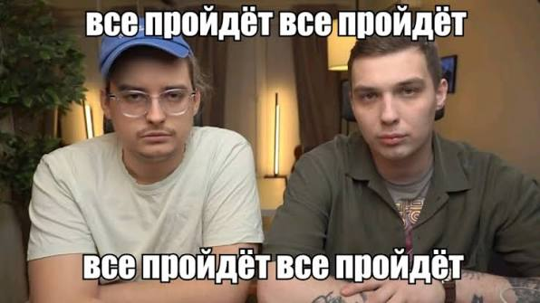

0. конфигурируем гит в терминале

1.  мы находимся в ветке main, видны неотслеживаемые скрытые файлы Finder и скриншоты.
2. `git log` вывел историю коммитов этого репозитория. Можно ранние увидеть коммиты синхронизации из Obsidian.
3. Напишем функцию сталинской сортировки на C и сохраним его в папку лабораторной:
4. Проверим состояние в git status:Появляется сообщение о удаленном файле README.md.md, так как он был переименован в README.md. В списке неотслеживаемых файлов отображаются скрытые папки и файлы программы Finder (.DS_Store), а также наши README.md и  stalin_sort.c.
5. Добавим эти файлы в область stage: 
6. Коммитим изменения:
7. Проверим git status:
8. Добавим в скрипт сортировки комментарий:
9. Проверим git status:
10. Добавим с помощью git add изменения в коммит:
11. Да, я думаю вы уже поняли, что мы снова будем делать:
12. Добавим еще комментарий
13. Коммититм и пушим:
14. 
15. 
16. 

# Ветки
1. 
2. 
3. 
4. 
5. 
6. 
7. 
8. 
9. 
10. Вот что изменилось: в git log для ветки main показваются коммиты, соответствующие только главной ветке, в то время как для mybranch там указываются все коммиты до ответвления и далее только коммиты этой ветки.
11. 
12. 
13. 
14. Да, пропал,  так как это другая ветка и туда text2.txt мы не добавляли.
15. Разница между ветками в том, что в `main` нет файлов .gitignore, applewatch.jpeg, file1.txt и meme.jpeg, meme.txt, зато есть text2.txt. То есть mybranch содержит файлы, которых нет в main, а main содержит text2.txt, которого нет в mybranch
16. 

## Оценка 4
1. Убедились, что мы на ветке mybranch
2. 
3. 
4. В самом деле пустой.
5. 
6. 
7. `git diff` сравнивает рабочую папку с индексом, а `git diff --staged` сравнивает индекс с последним коммитом.
8. 
9. 
10. --staged показывает изменения в файлах только добавленные к коммиту, без этого параметра diff показывает все изменения по сравнению с прошлым коммитом
11.  stalin_sort.c действительно отображается в поле изменных и в поле не добавленных в коммит.
12. 
13. 
14. 
15.  Не удалось!
16. Разрешим конфликт, нажав Accept Both Changes.

# **Ветки и ff-merge**
1. 
2. 
3. 
4. 
5. 
6. 
7. 
8. 
9. 
10. 
11. 
12. 
13. 
14. 
15. 
16. 
17. 
18. 
19. 
# **Merge конфликты** для сортировки MergeSort на python.

1. 
2. 
3. 
4. 
5. 
6. 
7. 
8. С первого раза не удалось.
9. Попытались устранить конфликты, сохранив логику программы
10. 

# На этом мой рабочий день окончен. Наверное.... 

